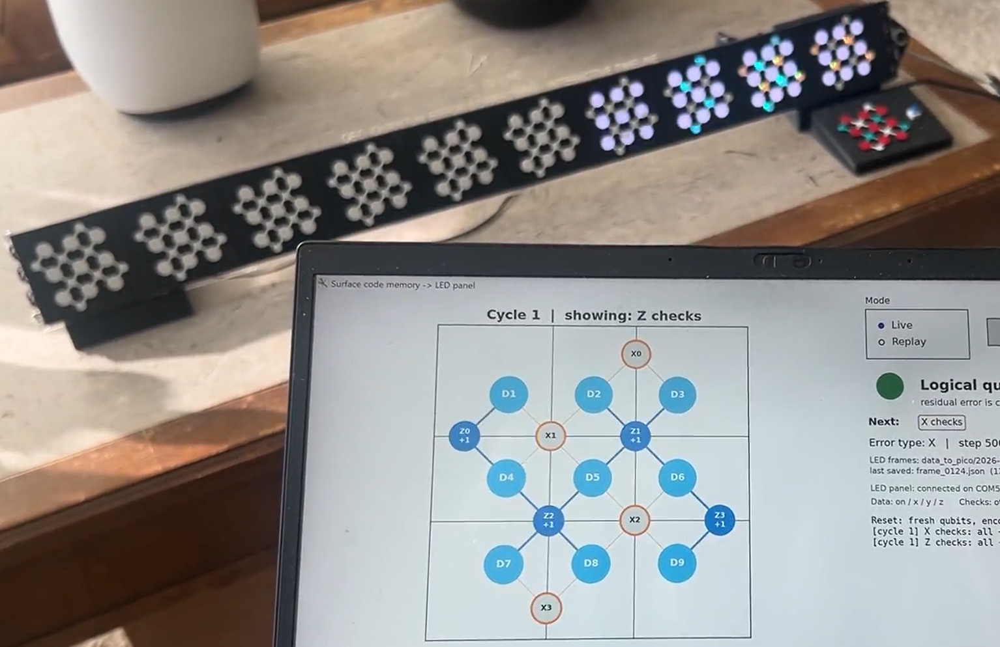
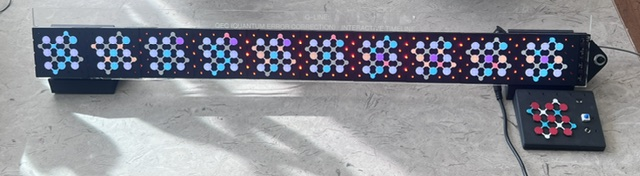

# The Q-Line
The Q-Line is a *QEC Syndrome Visualizer Timeline* for visualizing distance-3 rotated surface code using an interactive decoder and physical timeline display.  

## The Physical Device 
One acrylic plane displays 17 LEDs: 9 data qubit dots and 8 stabilizer checks (cyan = X-type, amber = Z-type) and these panes are repeated for 10 sequential points in time. New events are added from right to left, allowing for a chronological left to right viewing of the last 10 events of the timeline history.

The sequential timeline input can be fully automatic from the computer or interrupted for manual intervention. A visitor injects data or modifies X/Y/Z faults via buttons and requests the next frame when ready. A rotary encoder sets modes which the app can define. 

The core takeaway: a data error and a measurement error leave different spacetime signatures. The instrument makes that difference physically visible.

You can also [watch a short video of the q-line running in realtime](q-line.mp4)

## App & Display Device Interface
You can run this entire project locally with `uv run Run_Circuit.py`. 

See the [Display Device README](device/README.md) for setup, the Python API, JSON protocol, and emulator documentation.

If no physical device is detected, a local emulator launches automatically.

> [!WARNING]
>
> **Emulator is for interface development and testing only.**
>
> The emulator does **not** currently replicate the real device's firmware or behavior accurately. Use it only for testing the interface. Do not rely on it to validate hardware functionality or device-specific behavior.

